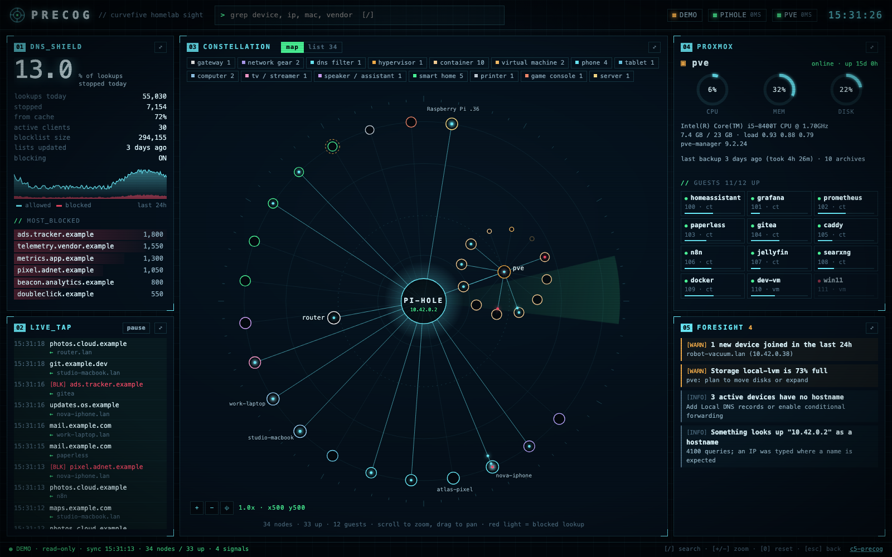

# Precog

**Your whole homelab at a glance.** A self-hosted, read-only dashboard for **Pi-hole v6** and **Proxmox VE**: every device on your network, what it is, where it runs (LAN, VM or container), what it talks to, and what needs attention.



Zero dependencies, one small container, MIT licensed. Built by [CurveFive](https://github.com/curvefive).

## Features

- **One-screen console:** DNS, Proxmox, live lookups and alerts side by side, no scrolling. Any panel expands full-screen (`⤢`, `Esc` to return).
- **Constellation:** devices grouped around Pi-hole by type; Proxmox guests orbit their host. DNS lookups fly in live, blocked ones turn red. Scroll to zoom, drag to pan: names, IPs and guest IDs appear as you zoom in.
- **Target lock:** click any device (map, list or Proxmox guest) to fly to it and see IP, MAC, maker, first/last seen and the domains it talks to. CPU, memory and uptime for guests.
- **Device list:** search (`/`), sort, filter by type. Guests are matched to DNS traffic by MAC.
- **DNS shield:** block rate, 24 h history, cache hits, blocklist age, top blocked domains, live lookups.
- **Proxmox:** CPU/memory/disk gauges, storage pools, guests, recent tasks, last backup.
- **Foresight alerts:** blocking off, stale blocklists, storage over 70/85 %, unrecovered failed tasks, no backup in 8 days, new devices, unnamed devices, IPs looked up as hostnames.

## Try it

```bash
git clone https://github.com/curvefive/c5-precog && cd c5-precog
npm run demo    # Node 20.6+
```

Or with Docker: `docker build -t c5-precog . && docker run --rm -p 8080:8080 -e DEMO=1 c5-precog`

Open <http://localhost:8080>. Demo mode uses a fake homelab; no credentials needed.

## Install

**1. Pi-hole app password:** Settings → Web interface / API → Configure app password.

**2. Read-only Proxmox token** (on any node):

```bash
pveum user add precog@pve --comment "Precog dashboard"
pveum acl modify / --users precog@pve --roles PVEAuditor
pveum user token add precog@pve dashboard --privsep 0   # copy the secret
```

`PVEAuditor` can only read. Don't grant more.

**3. Run:**

```bash
git clone https://github.com/curvefive/c5-precog && cd c5-precog
cp .env.example .env    # fill in the values
docker compose up -d --build
```

Without Docker: `node --env-file=.env server.js` (Node 20.6+). Uses ~60 MB RAM.

## Configuration

| Variable | Purpose |
|---|---|
| `PIHOLE_URL` | e.g. `http://192.168.1.2` (`/admin` suffix is fine) |
| `PIHOLE_PASSWORD` | Pi-hole **app password** |
| `PROXMOX_URL` | `https://<node>:8006` |
| `PROXMOX_TOKEN_ID` / `PROXMOX_TOKEN_SECRET` | Token from step 2, e.g. `precog@pve!dashboard` |
| `PROXMOX_CA_FILE` | Proxmox CA (`/etc/pve/pve-root-ca.pem`); mount it via `compose.yaml` |
| `PROXMOX_INSECURE_TLS` | `true` skips certificate checks (trusted LAN only) |
| `PRECOG_PASSWORD` / `PRECOG_USER` | Dashboard basic auth. **Set this.** |
| `PORT` / `HOST` / `POLL_SECONDS` | Defaults `8080` / `0.0.0.0` / `15` |
| `DEMO` | `1` for fake data (also the default when no source is set) |

Either source can be omitted; Precog shows what it has.

## Security

- **Read-only.** Upstream calls are `GET` only, plus Pi-hole login/logout. The dashboard API rejects non-`GET` with `405`.
- **Secrets stay server-side.** One Pi-hole session is reused and closed on shutdown.
- **Untrusted network data** (hostnames, domains) is always rendered as text, backed by a strict CSP with no third-party resources.
- **The dashboard reveals your whole network.** Set `PRECOG_PASSWORD` and never expose it to the internet; use a VPN (WireGuard, Tailscale) for remote access. Basic auth is only safe over a trusted network or behind HTTPS.

## How device mapping works

Precog combines Pi-hole's network table (ARP, MAC, maker, hostnames) and per-client stats with Proxmox guest configs (MAC → guest, live LXC IPs) and the default gateway. It knows *what* each device is and *which host* a guest runs on. Wi-Fi AP / switch port needs router data; adapters are on the roadmap.

## Development

```bash
npm test                    # unit + end-to-end against mock APIs
npm run demo                # http://localhost:8080
node dev/mock-servers.js    # fake Pi-hole :18081, Proxmox :18006
```

`lib/sources.js` API clients · `lib/model.js` fusion, classification, alerts · `lib/demo.js` fake data · `server.js` · `public/` (no build step).

## Roadmap

- Router adapters (UniFi, OPNsense, OpenWrt) for AP / switch port
- Multiple Pi-holes
- Proxmox Backup Server
- Device history and long-term trends

## License

MIT © CurveFive
